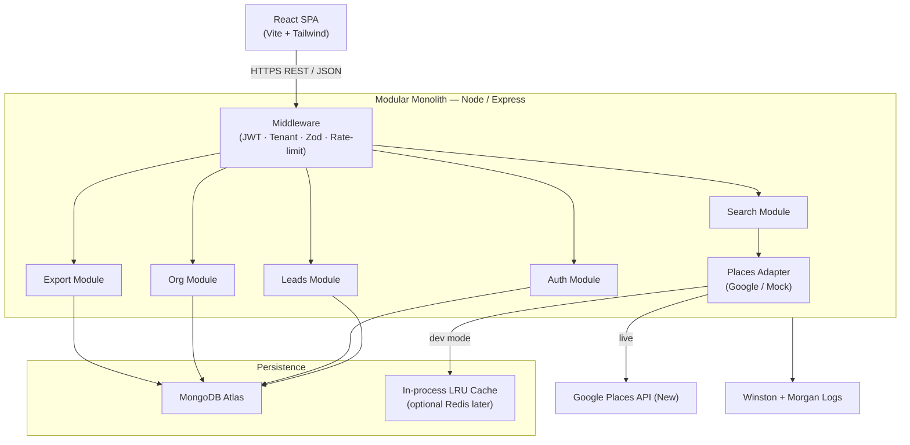
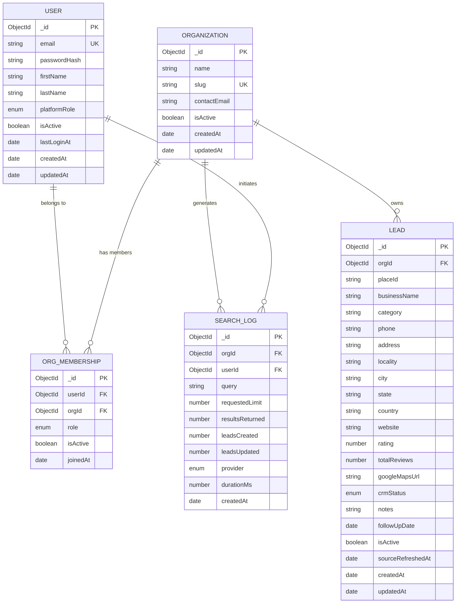
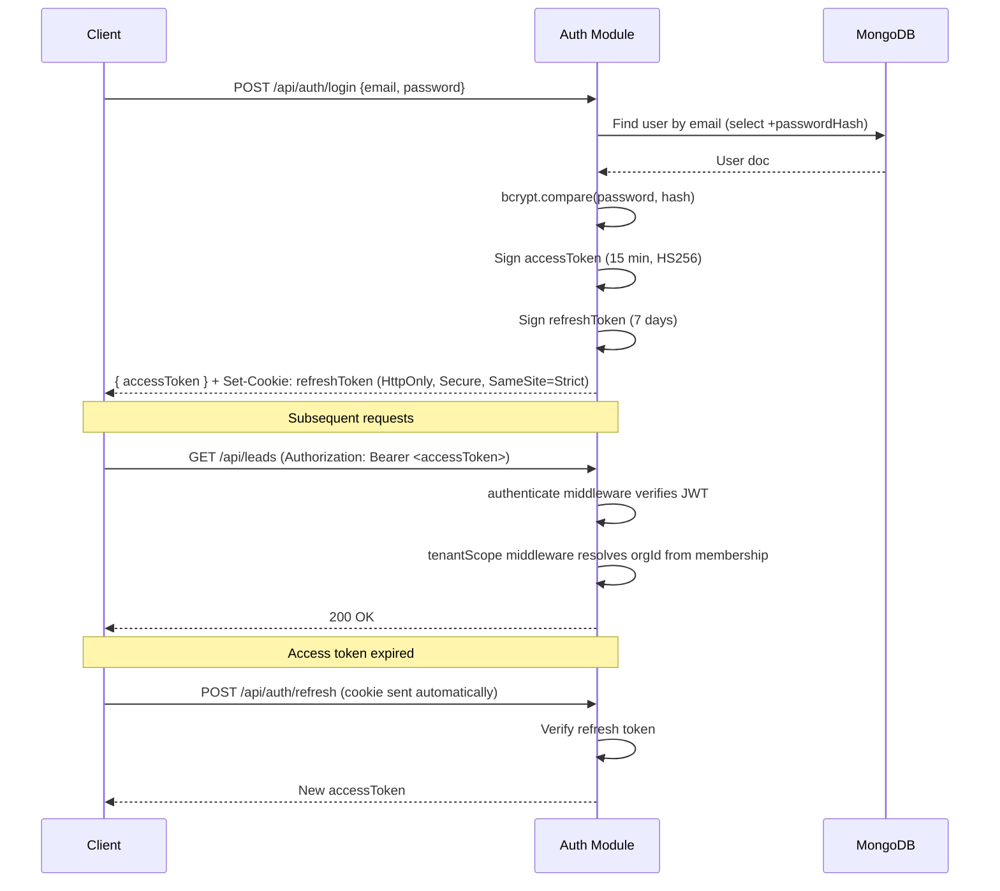
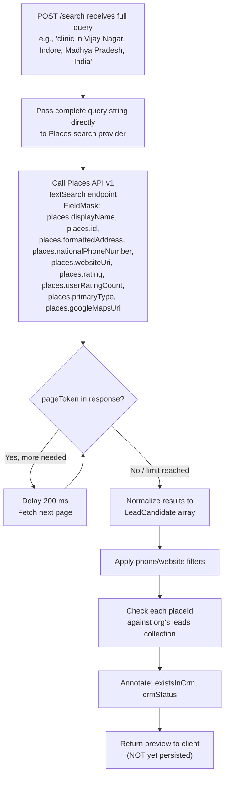
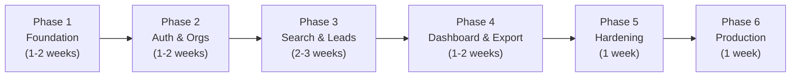

# Lead Generation CRM — Technical Blueprint

> **Status:** Awaiting approval before implementation begins.
> **Stack:** React + Vite · Tailwind · Node/Express · MongoDB Atlas · Mongoose · Google Places API (New)

---

## Table of Contents

1. [System Architecture](#1-system-architecture)
2. [Folder Structure](#2-folder-structure)
3. [MongoDB Schemas & Relationships](#3-mongodb-schemas--relationships)
4. [Authentication & Authorization Design](#4-authentication--authorization-design)
5. [Organization Isolation Strategy](#5-organization-isolation-strategy)
6. [API Endpoint Specifications](#6-api-endpoint-specifications)
7. [Google Places Integration Design](#7-google-places-integration-design)
8. [Duplicate Detection & Update Strategy](#8-duplicate-detection--update-strategy)
9. [Mock-Data Development Strategy](#9-mock-data-development-strategy)
10. [CSV / PDF Export Architecture](#10-csv--pdf-export-architecture)
11. [Security & Testing Plan](#11-security--testing-plan)
12. [Phase-by-Phase Implementation Plan](#12-phase-by-phase-implementation-plan)
13. [Acceptance Criteria per Phase](#13-acceptance-criteria-per-phase)
14. [API Billing & Data-Policy Risks](#14-api-billing--data-policy-risks)
15. [Assumptions & Open Decisions](#15-assumptions--open-decisions)

---

## 1. System Architecture

### 1.1 High-Level Overview



### 1.2 Architectural Decisions

| Decision | Choice | Rationale |
|---|---|---|
| Monolith vs micro-services | **Modular monolith** | Simpler ops; module boundaries allow future extraction |
| API secrets location | **Backend only** | Prevents key exposure in browser bundle |
| Tenancy model | **Shared database, shared collections, tenant-discriminator field** | Cost-effective at launch; upgrade path to dedicated DBs exists |
| Caching | **In-process LRU (node-lru-cache)** | No extra infra; swappable for Redis |
| Auth tokens | **Short-lived JWT access (15 min) + HTTP-only refresh cookie (7 days)** | Secure, stateless, standard |
| Places API version | **Google Places API (New) — Text Search & Place Details** | Compliance with current policy |
| Validation | **Zod schemas shared between route handlers** | Single source of truth |
| Environment toggle | `PLACES_PROVIDER=mock` env var | No code branching in business logic |

---

## 2. Folder Structure

```
sales-crm/
├── client/                          # React + Vite frontend
│   ├── public/
│   ├── src/
│   │   ├── api/                     # Axios instances & typed request helpers
│   │   │   ├── authApi.js
│   │   │   ├── leadsApi.js
│   │   │   └── searchApi.js
│   │   ├── assets/
│   │   ├── components/
│   │   │   ├── common/              # Button, Input, Modal, Badge, Spinner…
│   │   │   ├── layout/              # AppShell, Sidebar, Topbar
│   │   │   ├── leads/               # LeadTable, LeadCard, LeadDrawer, StatusBadge
│   │   │   ├── search/              # SearchForm, ResultsPreview, ImportConfirm
│   │   │   ├── dashboard/           # StatsCard, ActivityFeed
│   │   │   └── export/              # ExportModal
│   │   ├── contexts/                # AuthContext, OrgContext
│   │   ├── hooks/                   # useLeads, useSearch, usePagination, useDebounce
│   │   ├── pages/
│   │   │   ├── Login.jsx
│   │   │   ├── Register.jsx
│   │   │   ├── Dashboard.jsx
│   │   │   ├── Search.jsx
│   │   │   ├── Leads.jsx
│   │   │   ├── LeadDetail.jsx
│   │   │   ├── Settings.jsx
│   │   │   └── Admin.jsx            # Platform admin only
│   │   ├── store/                   # Zustand stores (auth, leads, search)
│   │   ├── utils/
│   │   │   ├── formatters.js
│   │   │   └── validators.js
│   │   ├── App.jsx
│   │   ├── main.jsx
│   │   └── router.jsx
│   ├── index.html
│   ├── vite.config.js
│   └── tailwind.config.js
│
├── server/                          # Express modular monolith
│   ├── src/
│   │   ├── config/
│   │   │   ├── env.js               # Validated env vars via envalid
│   │   │   ├── db.js                # Mongoose connection
│   │   │   └── logger.js            # Winston config
│   │   │
│   │   ├── modules/
│   │   │   ├── auth/
│   │   │   │   ├── auth.controller.js
│   │   │   │   ├── auth.service.js
│   │   │   │   ├── auth.routes.js
│   │   │   │   ├── auth.schema.js   # Zod
│   │   │   │   └── auth.test.js
│   │   │   │
│   │   │   ├── organizations/
│   │   │   │   ├── org.controller.js
│   │   │   │   ├── org.service.js
│   │   │   │   ├── org.routes.js
│   │   │   │   ├── org.schema.js
│   │   │   │   └── org.test.js
│   │   │   │
│   │   │   ├── users/
│   │   │   │   ├── user.controller.js
│   │   │   │   ├── user.service.js
│   │   │   │   ├── user.routes.js
│   │   │   │   ├── user.schema.js
│   │   │   │   └── user.test.js
│   │   │   │
│   │   │   ├── leads/
│   │   │   │   ├── lead.controller.js
│   │   │   │   ├── lead.service.js
│   │   │   │   ├── lead.routes.js
│   │   │   │   ├── lead.schema.js
│   │   │   │   ├── lead.model.js    # Mongoose model
│   │   │   │   └── lead.test.js
│   │   │   │
│   │   │   ├── search/
│   │   │   │   ├── search.controller.js
│   │   │   │   ├── search.service.js
│   │   │   │   ├── search.routes.js
│   │   │   │   ├── search.schema.js
│   │   │   │   └── search.test.js
│   │   │   │
│   │   │   └── export/
│   │   │       ├── export.controller.js
│   │   │       ├── export.service.js
│   │   │       ├── export.routes.js
│   │   │       └── export.test.js
│   │   │
│   │   ├── adapters/
│   │   │   ├── places/
│   │   │   │   ├── placesAdapter.js         # Interface / factory
│   │   │   │   ├── googlePlacesAdapter.js   # Live Google implementation
│   │   │   │   └── mockPlacesAdapter.js     # Dev mock
│   │   │   └── index.js
│   │   │
│   │   ├── middleware/
│   │   │   ├── authenticate.js      # JWT verification → req.user
│   │   │   ├── authorize.js         # Role guard factory
│   │   │   ├── tenantScope.js       # Injects & verifies orgId
│   │   │   ├── validate.js          # Zod middleware factory
│   │   │   ├── rateLimiter.js       # express-rate-limit
│   │   │   └── errorHandler.js      # Centralized error formatter
│   │   │
│   │   ├── models/
│   │   │   ├── User.js
│   │   │   ├── Organization.js
│   │   │   ├── OrgMembership.js
│   │   │   ├── Lead.js
│   │   │   └── SearchLog.js
│   │   │
│   │   ├── utils/
│   │   │   ├── asyncHandler.js      # Try/catch wrapper
│   │   │   ├── ApiError.js          # Custom error class
│   │   │   ├── ApiResponse.js       # Standard response envelope
│   │   │   ├── pagination.js
│   │   │   └── mergeLeadData.js     # Smart merge logic
│   │   │
│   │   └── app.js                   # Express app factory
│   │
│   ├── tests/
│   │   ├── integration/
│   │   └── fixtures/
│   ├── server.js                    # Entry point
│   ├── .env.example
│   └── package.json
│
├── docs/
│   ├── api-spec.yaml                # OpenAPI 3.1
│   ├── data-policy-audit.md         # Google Maps compliance notes
│   └── architecture-decisions.md
│
├── docker-compose.yml               # Local dev (Mongo + server + client)
└── README.md
```

---

## 3. MongoDB Schemas & Relationships

### 3.1 Entity Relationship Diagram



### 3.2 Schema Details

#### User
```javascript
{
  email:         { type: String, unique: true, lowercase: true, required: true },
  passwordHash:  { type: String, required: true, select: false },
  firstName:     { type: String, required: true, trim: true },
  lastName:      { type: String, required: true, trim: true },
  platformRole:  { type: String, enum: ['platform_admin', 'user'], default: 'user' },
  isActive:      { type: Boolean, default: true },
  lastLoginAt:   Date,
  // timestamps: true
}
```

#### Organization
```javascript
{
  name:         { type: String, required: true, trim: true },
  slug:         { type: String, unique: true, lowercase: true, required: true },
  contactEmail: { type: String, required: true },
  isActive:     { type: Boolean, default: true },
  // timestamps: true
}
```

#### OrgMembership
```javascript
{
  userId:   { type: ObjectId, ref: 'User', required: true },
  orgId:    { type: ObjectId, ref: 'Organization', required: true },
  role:     { type: String, enum: ['org_admin', 'member'], required: true },
  isActive: { type: Boolean, default: true },
  joinedAt: { type: Date, default: Date.now },
  // Compound unique index: { userId, orgId }
}
```

#### Lead

> [!IMPORTANT]
> `placeId` is stored for internal deduplication only, not displayed as a raw identifier to end users in contexts that would imply it's persistent/stable. Google permits storing Place IDs to facilitate future lookup.

```javascript
{
  orgId:           { type: ObjectId, ref: 'Organization', required: true, index: true },
  placeId:         { type: String, index: true },           // Google Place ID
  businessName:    { type: String, required: true, trim: true },
  category:        { type: String },
  phone:           { type: String },
  address:         { type: String },
  locality:        { type: String },
  city:            { type: String },
  state:           { type: String },
  country:         { type: String },
  website:         { type: String },
  rating:          { type: Number, min: 0, max: 5 },
  totalReviews:    { type: Number, min: 0 },
  googleMapsUrl:   { type: String },                        // Permitted display link

  // CRM fields — user-managed, never auto-overwritten
  crmStatus:       { type: String, enum: ['new','contacted','qualified','unqualified','converted','lost'], default: 'new' },
  notes:           { type: String, maxlength: 5000 },
  followUpDate:    { type: Date },

  isActive:        { type: Boolean, default: true },
  sourceRefreshedAt: { type: Date },                        // Last time API data was re-fetched
  // timestamps: true
  // Compound index: { orgId, placeId } — unique where placeId exists
}
```

#### SearchLog
```javascript
{
  orgId:           { type: ObjectId, ref: 'Organization', required: true },
  userId:          { type: ObjectId, ref: 'User', required: true },
  query:           { type: String, required: true, trim: true }, // Complete search query (e.g. "clinic in Vijay Nagar, Indore, Madhya Pradesh, India")
  requestedLimit:  Number,
  resultsReturned: Number,
  leadsCreated:    Number,
  leadsUpdated:    Number,
  provider:        { type: String, enum: ['google', 'mock'] },
  durationMs:      Number,
  createdAt:       { type: Date, default: Date.now },
}
```

### 3.3 Index Strategy

| Collection | Index | Type | Purpose |
|---|---|---|---|
| users | `email` | Unique | Lookup on login |
| org_memberships | `{ userId, orgId }` | Unique compound | Prevent double-membership |
| org_memberships | `{ orgId }` | Regular | List org members |
| leads | `{ orgId, placeId }` | Unique sparse | Deduplication |
| leads | `{ orgId, crmStatus }` | Regular | Filter by status |
| leads | `{ orgId, createdAt }` | Regular | Default sort |
| leads | `{ orgId, city, state }` | Regular | Location filter |
| search_logs | `{ orgId, createdAt }` | Regular | Activity log |

---

## 4. Authentication & Authorization Design

### 4.1 Token Flow



### 4.2 JWT Payload

```json
{
  "sub": "<userId>",
  "platformRole": "user",
  "iat": 1234567890,
  "exp": 1234568790
}
```

> [!NOTE]
> `orgId` is **not** embedded in the JWT. It is resolved server-side from `OrgMembership` on every request using the `tenantScope` middleware. This prevents a user from escalating to another org by forging a token payload.

### 4.3 Role Matrix

| Action | Platform Admin | Org Admin | Member | Unauthenticated |
|---|---|---|---|---|
| Manage platform orgs | ✅ | ❌ | ❌ | ❌ |
| Invite/remove members | ❌ | ✅ | ❌ | ❌ |
| Change member roles | ❌ | ✅ | ❌ | ❌ |
| Run searches | ✅ | ✅ | ✅ | ❌ |
| View leads | ✅ | ✅ | ✅ | ❌ |
| Edit lead CRM fields | ✅ | ✅ | ✅ | ❌ |
| Delete leads | ❌ | ✅ | ❌ | ❌ |
| Export data | ✅ | ✅ | ✅ | ❌ |
| View all orgs' data | ✅ | ❌ | ❌ | ❌ |

### 4.4 Password Policy

- Minimum 8 characters, at least one uppercase, one number
- Hashed with `bcrypt`, cost factor 12
- No password stored in logs, error responses, or JWT

---

## 5. Organization Isolation Strategy

### 5.1 Tenancy Model: Shared Database, Discriminator Field

Every document that belongs to an organization carries `orgId: ObjectId`. All queries in the `leads`, `search_logs` modules **must** include `{ orgId: req.orgId }` as a filter predicate.

### 5.2 `tenantScope` Middleware

```
Request arrives with valid JWT (userId resolved)
  ↓
tenantScope reads `X-Org-Id` header (or query param for GET requests)
  ↓
Queries OrgMembership: { userId, orgId: requestedOrgId, isActive: true }
  ↓
NOT FOUND → 403 Forbidden
  ↓
FOUND → attaches { orgId, orgRole } to req
  ↓
Controller uses req.orgId — never req.body.orgId or req.params.orgId from untrusted sources
```

### 5.3 Platform Admin Bypass

Platform admins may supply any `orgId` via `X-Org-Id` without a membership check — enforced in `tenantScope` by checking `req.user.platformRole === 'platform_admin'`.

### 5.4 Data Isolation Guarantees

- Mongoose queries always receive `orgId` filter from middleware, not from client payload
- Leads cannot be read, updated, or exported across org boundaries
- OrgMembership compound unique index prevents phantom memberships
- `organization.slug` is public (used in URL), but `organization._id` drives all queries

---

## 6. API Endpoint Specifications

### Base URL: `/api/v1`

All responses follow the envelope:
```json
{ "success": true, "data": {}, "message": "...", "meta": { "page": 1, "total": 42 } }
```
Errors:
```json
{ "success": false, "error": { "code": "LEAD_NOT_FOUND", "message": "..." } }
```

---

### 6.1 Auth Routes

| Method | Path | Auth | Description |
|---|---|---|---|
| POST | `/auth/register` | No | Register new user + create personal org |
| POST | `/auth/login` | No | Issue access + refresh tokens |
| POST | `/auth/refresh` | Cookie | Rotate access token |
| POST | `/auth/logout` | Bearer | Clear refresh cookie |
| GET | `/auth/me` | Bearer | Current user profile |
| PATCH | `/auth/me` | Bearer | Update profile (name, password) |

---

### 6.2 Organization Routes

| Method | Path | Auth | Description |
|---|---|---|---|
| GET | `/orgs` | Platform Admin | List all organizations |
| POST | `/orgs` | Platform Admin | Create organization |
| GET | `/orgs/:orgId` | Org Admin+ | Get org details |
| PATCH | `/orgs/:orgId` | Org Admin | Update org settings |
| DELETE | `/orgs/:orgId` | Platform Admin | Soft-delete org |

---

### 6.3 Membership Routes

| Method | Path | Auth | Description |
|---|---|---|---|
| GET | `/orgs/:orgId/members` | Org Admin | List members |
| POST | `/orgs/:orgId/members/invite` | Org Admin | Invite by email |
| PATCH | `/orgs/:orgId/members/:userId` | Org Admin | Change role |
| DELETE | `/orgs/:orgId/members/:userId` | Org Admin | Remove member |

---

### 6.4 Search Routes

| Method | Path | Auth | Description |
|---|---|---|---|
| POST | `/search` | Member+ | Run a Places search, return preview array |
| POST | `/search/import` | Member+ | Persist selected results as leads |
| GET | `/search/logs` | Org Admin | Paginated search history |

**POST `/search` request body (Zod schema):**
> [!NOTE]
> Revised Lead Search Experience (Phase 3): Users enter the complete search query in one input (e.g. `clinic in Vijay Nagar, Indore, Madhya Pradesh, India`). No separate country, state, city, or locality dropdowns are used. The complete query is passed directly to the Places search provider.

```typescript
{
  query:     string (min 2, max 200), // Complete search query (e.g., 'clinic in Vijay Nagar, Indore, Madhya Pradesh, India')
  limit:     enum [20, 50, 100],
  filters?: {
    requirePhone:   boolean,
    requireWebsite: boolean,
  }
}
```

**POST `/search` response:**
```json
{
  "results": [
    {
      "placeId": "...",
      "businessName": "...",
      "category": "...",
      "phone": "...",
      "address": "...",
      "city": "...",
      "state": "...",
      "country": "...",
      "website": "...",
      "rating": 4.2,
      "totalReviews": 128,
      "googleMapsUrl": "...",
      "existsInCrm": true,
      "crmStatus": "contacted"
    }
  ],
  "provider": "google",
  "totalFetched": 43
}
```

---

### 6.5 Lead Routes

| Method | Path | Auth | Description |
|---|---|---|---|
| GET | `/leads` | Member+ | Paginated lead list with filters/sort |
| GET | `/leads/:leadId` | Member+ | Single lead detail |
| PATCH | `/leads/:leadId` | Member+ | Update CRM fields (status, notes, followUp) |
| PATCH | `/leads/:leadId/refresh` | Member+ | Re-fetch source data from Places API |
| DELETE | `/leads/:leadId` | Org Admin | Soft-delete lead |
| DELETE | `/leads` | Org Admin | Bulk soft-delete (body: `{ ids: [] }`) |

**GET `/leads` query params:**
```
page, limit, sortBy, sortOrder,
status, city, state, country, category,
hasPhone, hasWebsite, search (full-text on name/address),
followUpBefore, followUpAfter,
createdBefore, createdAfter
```

---

### 6.6 Export Routes

| Method | Path | Auth | Description |
|---|---|---|---|
| POST | `/export/csv` | Member+ | Export leads to CSV stream |
| POST | `/export/pdf` | Member+ | Export leads to PDF download |

**POST `/export/csv` request body:**
```json
{
  "ids": ["..."],          // export selected; omit for filtered
  "filters": {},           // same filter params as GET /leads
  "fields": ["businessName","phone","website","crmStatus"]
}
```

---

### 6.7 Dashboard Routes

| Method | Path | Auth | Description |
|---|---|---|---|
| GET | `/dashboard/stats` | Member+ | Aggregate counts by status, location |
| GET | `/dashboard/activity` | Member+ | Recent search logs |

---

## 7. Google Places Integration Design

### 7.1 Policy Compliance Summary

> [!CAUTION]
> The Google Maps Platform Terms of Service restrict what data may be cached/stored. This section documents our interpretation and must be reviewed against the **current** policy before each production release.

| Data | Status | Our Approach |
|---|---|---|
| Place ID | ✅ May store | Stored for deduplication; stable identifier per ToS |
| Business name | ✅ May display; cache within ToS limits | Stored |
| Address, phone, website | ✅ May display | Stored |
| Rating, review count | ⚠️ Must be kept fresh; attribution required | Stored with `sourceRefreshedAt`; refreshed on detail view |
| Google Maps URL | ✅ Deep links permitted | Stored |
| Photos | ❌ No long-term caching | Not stored or served |
| Business owner email | ❌ Not available from Places API | Not attempted |
| "Claimed" / verification status | ❌ Not reliably available | Not stored |
| User-generated review text | ❌ Subject to additional ToS | Not stored |
| Place geometry (lat/lng) | ✅ May store | Optionally stored for mapping later |

**Attribution requirement:** Any UI displaying Google Places data must show "Powered by Google" and link back to Google Maps as required.

### 7.2 Text Search Flow (Google Places API New)



### 7.3 Field Mask (FieldMask Header)

```
places.id,
places.displayName,
places.formattedAddress,
places.nationalPhoneNumber,
places.internationalPhoneNumber,
places.websiteUri,
places.rating,
places.userRatingCount,
places.primaryType,
places.types,
places.googleMapsUri,
places.addressComponents
```

> [!NOTE]
> Only request fields you actually use. Unused fields in the mask still count toward SKU billing tiers.

### 7.4 Pagination Strategy

- Google Places New API returns up to **20 results per page** and supports `pageToken` for subsequent pages.
- To reach a limit of 50 or 100, we issue up to 5 consecutive requests with the `pageToken`.
- Each page request is separated by a **200 ms delay** to avoid rate-limit errors.
- If any intermediate page fails, we return what we have and annotate `partialResults: true` in the response.
- We log total time and result count in `SearchLog`.

### 7.5 Quota & Error Handling

| Scenario | Behavior |
|---|---|
| `RESOURCE_EXHAUSTED` (429) | Exponential back-off × 3, then fail with `503` to client |
| `INVALID_ARGUMENT` | Propagate as `400` with sanitized message |
| `NOT_FOUND` | Return empty array |
| Network timeout (>10 s) | Fail with `504`, `partialResults: false` |
| Partial page failure | Return accumulated results, `partialResults: true` |

---

## 8. Duplicate Detection & Update Strategy

### 8.1 Deduplication Key

**Primary key:** `{ orgId, placeId }` — MongoDB unique sparse index ensures no two leads in the same org share a Place ID.

**Fallback key (when placeId is absent):** Normalized `{ orgId, businessName (lowercase, trimmed), city (lowercase) }` — used as a soft-match signal, not a hard constraint.

### 8.2 Import Merge Logic (`mergeLeadData.js`)

```
For each candidate in import batch:
  1. Lookup existing lead: Lead.findOne({ orgId, placeId })
  2. NOT FOUND → create new lead, set crmStatus = 'new'
  3. FOUND →
     a. Build update object from API fields ONLY
     b. For each API field, apply: newValue ?? existingValue
        (Never overwrite existing truthy value with null/undefined)
     c. NEVER touch: crmStatus, notes, followUpDate
     d. Set sourceRefreshedAt = now
     e. Lead.findByIdAndUpdate(id, update, { new: true })
  4. Log created/updated counts in SearchLog
```

### 8.3 Refresh Flow (`PATCH /leads/:leadId/refresh`)

- Re-calls `Place Details` endpoint for the stored `placeId`
- Applies the same merge logic: source fields updated, CRM fields untouched
- Returns the merged lead document
- Respects the same field-mask and ToS constraints

---

## 9. Mock-Data Development Strategy

### 9.1 Activation

Set `PLACES_PROVIDER=mock` in `.env`. The `placesAdapter.js` factory returns `mockPlacesAdapter` instead of `googlePlacesAdapter`. Zero changes to any service or controller code.

### 9.2 Mock Adapter Behavior

- Returns deterministic fake results based on a hash of the query string (same query → same results)
- Fixture file: `server/src/adapters/places/fixtures/mockLeads.json` (~200 entries across various business types)
- Simulates pagination delay (configurable `MOCK_DELAY_MS`, default 300)
- Simulates error scenarios via special query keywords:
  - `"error:429"` → simulates quota exceeded
  - `"error:timeout"` → simulates network timeout
  - `"error:partial"` → returns first page, fails on second

### 9.3 Mock Data Structure

Each fixture entry mirrors the normalized `LeadCandidate` shape, not raw Google API format, so the rest of the pipeline is unaware it is mock data.

### 9.4 Fixture Content

Mock fixtures will include:
- 10 categories (Clinics, Restaurants, Gyms, Schools, Hotels, Pharmacies, Law Firms, Salons, Cafés, Real-Estate Agencies)
- Businesses across 5 Indian cities (Indore, Mumbai, Delhi, Bangalore, Hyderabad)
- Mixed presence of phone, website, and rating data
- Mix of new and already-imported scenarios

---

## 10. CSV / PDF Export Architecture

### 10.1 Data Policy for Exports

> [!CAUTION]
> Exported files contain Google Places data. Per ToS, exported data must not be used to build competing mapping products and must remain subject to the same use restrictions. We display a notice in the export UI and in PDF headers.

### 10.2 CSV Export

**Library:** `fast-csv`

**Flow:**
```
POST /export/csv
  → validate request (Zod)
  → resolve org leads (same query logic as GET /leads, no separate N+1)
  → pipe Lead cursor → fast-csv transform → res (Content-Disposition: attachment)
  → streaming, no full in-memory load
```

**Permitted export fields:**
```
businessName, category, phone, address, locality, city, state, country,
website, rating, totalReviews, googleMapsUrl, crmStatus, notes,
followUpDate, createdAt, updatedAt
```

**Excluded from export:** `_id`, `orgId`, `placeId` (internal), `passwordHash`

### 10.3 PDF Export

**Library:** `pdfkit` (no external services)

**Layout:**
- Header: Org name, export date, "Powered by Google" attribution
- Summary stats block
- Table: up to 10 columns, font size scales to fit
- Footer: page numbers, data-use notice
- Streaming: `PDFDocument.pipe(res)` — no temp file on disk

### 10.4 Export Limits

| Tier | CSV | PDF |
|---|---|---|
| Per request max rows | 10,000 | 2,000 |
| Reason | Memory protection | PDF generation time |

Requests exceeding limits receive `400` with a suggestion to apply stricter filters.

---

## 11. Security & Testing Plan

### 11.1 Security Measures

| Layer | Measure |
|---|---|
| Transport | HTTPS only in production; HSTS header |
| Auth | JWT HS256, short-lived access tokens, HttpOnly refresh cookie |
| Input | Zod validation on all route inputs; MongoDB query injection prevented by Mongoose |
| Rate limiting | `express-rate-limit`: 100 req/15 min general; 10 req/15 min on auth routes; 5 searches/min |
| Headers | `helmet` (CSP, X-Frame-Options, etc.) |
| CORS | Allowlist of known origins only |
| Secrets | Only in `.env`, never logged, never in Git |
| Password | bcrypt cost 12 |
| Org isolation | `tenantScope` middleware on every data route |
| Logging | Winston logs sanitized — no passwords, tokens, or raw API keys |
| Dependencies | `npm audit` in CI; `dependabot` alerts |

### 11.2 Testing Plan

| Layer | Tool | Coverage Goal |
|---|---|---|
| Unit — services | **Vitest** (server) | 80% of service functions |
| Unit — utils | Vitest | 90% of utility functions |
| Integration — API routes | **Supertest** + in-memory MongoDB (**@jest-community/jest-mongodb** or **mongodb-memory-server**) | All endpoints, happy + error paths |
| Frontend components | **Vitest** + **@testing-library/react** | Core components |
| E2E (Phase 4+) | **Playwright** | Critical user journeys |

**Key test scenarios:**
- Auth: register, login, invalid password, token refresh, logout
- Tenant isolation: user in Org A cannot read Org B's leads
- Search: pagination, partial failure, mock provider, deduplication
- Import: create new lead, update existing (CRM fields preserved), bulk import
- Export: CSV column correctness, PDF generation, row limit enforcement
- RBAC: member cannot delete, org admin cannot access platform admin routes

---

## 12. Phase-by-Phase Implementation Plan



### Phase 1 — Foundation
- Scaffold monorepo (`client/`, `server/`)
- Configure Vite + Tailwind + ESLint + Prettier
- Configure Express + Mongoose + Winston + Helmet
- `.env` validation with `envalid`
- Docker Compose for local MongoDB
- CI pipeline skeleton (GitHub Actions)
- `ApiError`, `ApiResponse`, `asyncHandler` utilities

### Phase 2 — Auth & Organizations
- `User`, `Organization`, `OrgMembership` models + indexes
- Auth routes: register, login, refresh, logout, me
- `authenticate` + `authorize` + `tenantScope` middleware
- Org CRUD + membership invite/remove
- Frontend: Login, Register, basic AppShell, AuthContext

### Phase 3 — Search & Leads (Core Value)
- Revised Lead Search Experience: Single-input search query (e.g. `clinic in Vijay Nagar, Indore, Madhya Pradesh, India`), no dropdowns; complete query passed directly to Places search provider
- `mockPlacesAdapter` with fixtures supporting complete query strings
- `googlePlacesAdapter` with pagination + error handling using complete query string
- `placesAdapter` factory toggled by env
- Search routes: `/search`, `/search/import`
- `Lead` model + indexes
- `mergeLeadData` utility
- `SearchLog` model (tracking full query string)
- Frontend: SearchForm (single query input), ResultsPreview, ImportConfirm modal, LeadsTable, LeadDrawer

### Phase 4 — Dashboard & Export
- Dashboard stats aggregation pipeline
- Recent activity feed
- CSV export with streaming
- PDF export with pdfkit
- ExportModal with field selector
- Frontend: Dashboard page, Export modal

### Phase 5 — Hardening & Quality
- Full integration test suite
- Frontend component tests
- Playwright E2E for 3 critical journeys
- Rate limiting, CORS, security headers review
- OpenAPI 3.1 spec generation
- Data policy audit documentation

### Phase 6 — Production Readiness
- MongoDB Atlas production cluster config
- Production env vars checklist
- Deployment pipeline (e.g., Railway / Render / VPS)
- README, onboarding guide
- Final security pass: `npm audit`, secret scanning

---

## 13. Acceptance Criteria per Phase

### Phase 1
- [ ] `npm run dev` starts both client (port 5173) and server (port 5000)
- [ ] MongoDB connection established; disconnection is logged and retried
- [ ] All environment variables validated at startup; missing required vars crash with a clear message
- [ ] ESLint and Prettier pass with zero errors
- [ ] Health check `GET /api/v1/health` returns `{ status: "ok", db: "connected" }`

### Phase 2
- [ ] User can register with email + password; receives `accessToken`
- [ ] Incorrect password returns `401` with generic message (no user enumeration)
- [ ] Access token expires after 15 min; refresh token rotates correctly
- [ ] Org admin cannot access another org's members list
- [ ] Member cannot invite or remove users
- [ ] Platform admin can list all organizations
- [ ] All auth routes pass integration tests

### Phase 3
- [ ] Users enter complete search query in one input (e.g. `clinic in Vijay Nagar, Indore, Madhya Pradesh, India`), no dropdowns
- [ ] `PLACES_PROVIDER=mock` returns seeded fixture data without calling Google using the complete query string
- [ ] Search with `limit=50` returns ≤50 results, paginating across multiple API pages
- [ ] Duplicate Place ID within same org is not created twice
- [ ] Re-importing a lead updates source fields but preserves `crmStatus`, `notes`, `followUpDate`
- [ ] `partialResults: true` is returned when an intermediate page fails
- [ ] Leads table renders with filter, sort, and pagination working correctly
- [ ] Lead CRM fields editable inline; changes persist on reload

### Phase 4
- [ ] Dashboard shows correct counts per `crmStatus`
- [ ] CSV download contains selected columns; no `_id`, `orgId`, or `placeId`
- [ ] PDF download includes "Powered by Google" attribution
- [ ] Export respects active filters (filtered export) and selected IDs (bulk export)
- [ ] Requests exceeding row limits return `400`

### Phase 5
- [ ] Integration test suite passes with zero failures
- [ ] Tenant isolation test: user in Org A receives `403` when querying Org B's leads
- [ ] Rate limiter returns `429` after threshold is exceeded
- [ ] OpenAPI spec validates against all implemented routes
- [ ] `npm audit` reports no high-severity vulnerabilities

### Phase 6
- [ ] Application deployed and reachable at production URL
- [ ] Production MongoDB Atlas connection uses separate credentials from dev
- [ ] Refresh cookie flagged `Secure` and `SameSite=Strict` in production
- [ ] Logs written to persistent log storage (not just stdout)
- [ ] README documents local setup in ≤10 steps

---

## 14. API Billing & Data-Policy Risks

### 14.1 Google Places API Billing

| SKU | Trigger | Price (approx.) | Mitigation |
|---|---|---|---|
| Text Search (New) | Per page of results | ~\$32 / 1000 requests | Rate limit searches per org; cache deduplication check before re-fetching |
| Place Details (New) | Per detail fetch (refresh) | ~\$17 / 1000 | Only refresh on explicit user action |
| Basic Data fields | Included in Text Search | — | Use FieldMask; don't request unused fields |
| Contact Data fields | Additional SKU if requested | ~\$3 / 1000 additional | `nationalPhoneNumber` is Contact Data; budget accordingly |
| Atmosphere Data fields | Additional SKU | ~\$5 / 1000 additional | Rating/review count is Atmosphere Data |

> [!CAUTION]
> A single search for 100 results costs 5 page requests × Text Search SKU. At scale (100 users × 10 searches/day), monthly API costs could reach **\$1,600+/month** before any Place Details calls. Implement per-org monthly search quotas before enabling live API.

**Cost controls to implement:**
- Per-org configurable monthly search limit (default: 200 searches)
- Admin dashboard showing API usage estimates
- Warn users when approaching quota
- LRU cache for identical queries within 1 hour

### 14.2 Data Policy Risks

| Risk | Severity | Mitigation |
|---|---|---|
| Storing restricted Google data | High | Follow field table in §7.1; legal review before launch |
| Rating data staleness (ToS requires freshness) | Medium | `sourceRefreshedAt` field; highlight stale data in UI |
| Attribution missing in exports | Medium | "Powered by Google" in all PDF exports |
| Scraping or policy circumvention | Critical | Not implemented; not planned |
| Google changing ToS | Medium | Schedule quarterly policy reviews; modular adapter isolates changes |

---

## 15. Assumptions & Open Decisions

### Decisions Needed From You

| # | Question | Options | Impact |
|---|---|---|---|
| 1 | **Invite mechanism** — how do org admins invite users? | (a) Email invite link, (b) Admin creates credentials directly | Requires email service if (a) |
| 2 | **Email service** | SendGrid, Resend, SMTP, or skip for Phase 1 | Affects Phase 2 invite flow |
| 3 | **Deployment target** | Render, Railway, VPS, AWS | CI/CD config, Docker strategy |
| 4 | **Domain/URL structure** | Single domain (`/app`, `/api`) vs subdomain (`api.domain.com`) | CORS, cookie SameSite config |
| 5 | **Rating freshness policy** | Refresh after N days, or only on explicit user action | Affects background job need |
| 6 | **Org creation flow** | Self-serve (user registers → gets an org) or admin-only org creation | Multi-tenant growth model |
| 7 | **Locality field sourcing** | Derived from `addressComponents` or separate user input | API parsing complexity |
| 8 | **Lead deletion** | Hard delete or soft delete (isActive flag) | Data recovery, audit trail |
| 9 | **Maps display in UI** | Embed a Google Map iframe, or just show a link | Requires Maps JS API key (separate billing) |
| 10 | **Initial user seeding** | Migrations script / admin CLI command vs manual Atlas setup | Dev onboarding |

### Assumptions Made

- Soft delete is preferred (answered as soft delete above; confirm)
- India is the primary market but international locations are supported by design
- No email verification in Phase 1 (can be added in Phase 5)
- No subscription tiers or payment processing (confirmed in requirements)
- Google Places API (New) — Text Search v1 endpoint is the primary data source
- Business owner emails are not available from Places API (confirmed, no scraping)
- "Claimed" status is not available from Places API (confirmed)
- `googleMapsUrl` from the API response is used directly (no construction from Place ID)
- PDF exports use pdfkit (server-side, no headless browser)
- React state management via Zustand (lightweight, sufficient for this scope)

---

*This document will be updated as decisions are made. Implementation begins only after explicit approval.*
